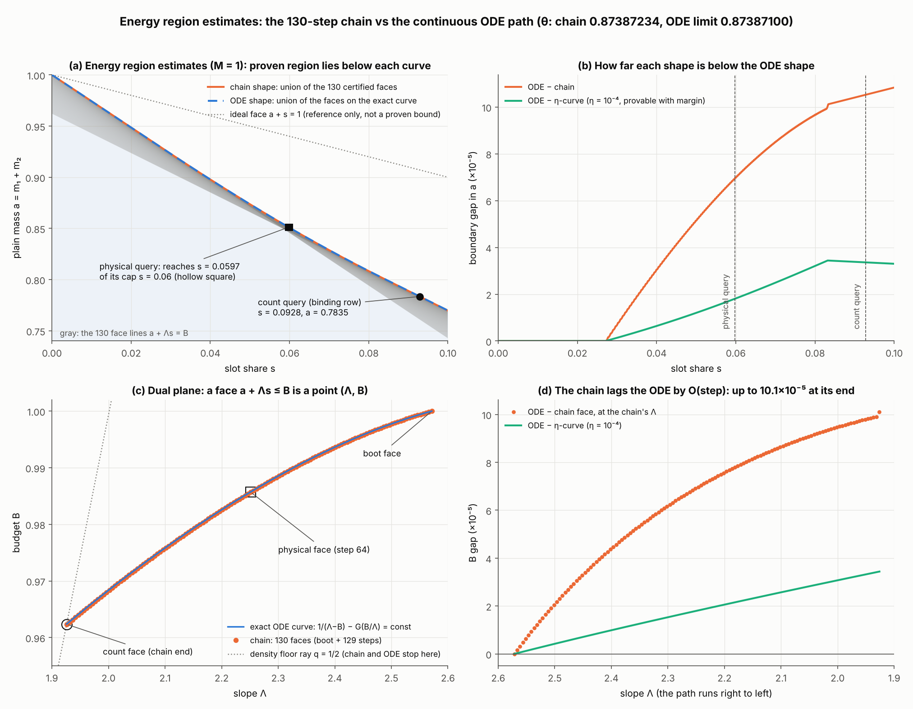

# Energy region estimates as shapes: what the return queries, and the continuous ODE shape

Date 2026-10-29. Tags: **[Lean]** compiled Lean (axioms `propext, Classical.choice, Quot.sound`); **[numerical]**
float/mpmath model (`research/return-tuning/model.py`, the return of PR #94); **[derived]** our derivation.

`fig/zones.png` (`fig_zones.py`): (a) the chain shape (union of the 130 certified faces) and the ODE shape in the
plane (slot share s, plain mass a = m₁ + m₂) at M = 1, with the two queries of the return; (b) the boundary
gaps; (c) the dual plane, where a face a + Λs ≤ B is the point (Λ, B); (d) the B gap at equal Λ.

## 1. The return reads a shape through one functional

The return applies the energy bound to single configurations and checks that they lie in the proven shape.
Every consumer asks the same question: **how much slot mass does the shape admit at a given plain level?**
That is the slot profile z_R(a) = sup{s : (a/2, a/2, s, 1) ∈ R}.

- **Count windows.** The witness is the configuration (m, m, z(m)) of the three-line crossing
  (`Return/Formulas.lean`, `Z = 2pB/Λ` or the cap) [Lean].
- **Physical numerator.** `newCapacity d = min(numeratorCap·d, (2y − (2 − B)d)/Λ)` is the largest slot mass
  at plain lengths d − y, M = d (`ReturnD/PhysicalDirect/Input.lean`, hypothesis `hcap`) [Lean].
- **The density step itself** reads its parent the same way: `z ≤ min(hQ, (BQ − y)/λ)` in the plain witness
  of the repeated-mark gain (`Gain/Gain.lean`, docstring and `plainThr`) [Lean].

For a union, z_{R ∪ R'} = max(z_R, z_R'), so each consumer automatically uses the best proven part.
The merged return already does this with two faces (step 64 for the physical query, the chain end for the
count). Over all 131 chain faces the binding queries already sit on their best face
(`return-tuning/README.md` §2, analyze3/analyze4) [numerical].

**Lean** (`research/lean/arvi_energy_region/`):

| file | content |
|---|---|
| `EnergyRegion.lean` | energy region, `IsEstimate`, lattice (join = union), `arviZone` = ⋃ of all estimates, `arviZone_isLUB`, `mem_arviZone_iff` |
| `ShapeStep.lean` | `density_shape_step` (a shape containing the parent face grows by the child face), `ode_shape_subset_arviZone` |
| `ShapeEndpoint.lean` | `ShapeReturn.beta_le_theta_of_estimate`: the return from **any** estimate R that contains the 31 count windows and the physical face; `beta_le_theta_of_two_face_shape` = the merged return as R = C ∪ P |

## 2. What the downstream gains from better shapes [numerical, `theta_of_faces.py`]

Least θ certifiable by the merged return (binding row newTop, p = 1/2, branch C; h at its ceiling; reserve 1e-8):

| change | θ* | vs merged 0.87387234 |
|---|---|---|
| merged faces (chain end, step 64) | 0.8738723399 | 0 |
| count face B + 1e-5 | | −7.2e-8 (∂θ/∂B_C ≈ −7.2e-3) |
| count face Λ − 1e-4 | | −6.7e-8 |
| physical face B + 1e-5 (capacity +2.6e-6) | | −8.4e-8 (∂θ/∂capacity ≈ −0.032) |
| physical query reaching its cap 0.06 (capacity +2.1e-4) | | about −6.5e-6 |

## 3. The continuous ODE shape replaces the 130 steps [numerical, `eta_cost.py`, `stop_cost.py`]

The provable continuous shape is the η-curve dB/dΛ = (B − k)/(Λ − k) with k = κ(q) − η, started at the boot
face. A finite density step loses against the exact curve, because the density cut depends on the step size,
so the exact curve is the limit as η → 0. Count face: the curve point at q_stop; physical face: the best curve point.

| shape | θ* | vs merged |
|---|---|---|
| 130-step chain | 0.8738723399 | 0 |
| η = 1e-4, q_stop = 0.5030 | 0.8738720553 | −2.9e-7 |
| η = 1e-4, q_stop = 0.5015 | 0.8738717195 | −6.2e-7 |
| η = 1e-4, q_stop = 0.5 | 0.8738713910 | −9.5e-7 |
| η = 1e-5, q_stop = 0.5 | 0.8738710363 | −1.30e-6 |
| exact ODE (limit) | 0.8738709968 | −1.34e-6 |

So the continuous shape is both simpler and better than the chain.

## 4. Plan: the ODE-inequality theorem (no steps, no certificates)

**Theorem (target).** Let β be concave on [Λa, Λb] with β′(Λ) ≥ σ(β(Λ), Λ) + μ and the curve inside the band,
and let the boot face (β(Λb), Λb) be proven. Then every face (β(Λ), Λ, 1/10), Λ ∈ [Λa, Λb], is proven.

The energy region estimate is defined by a differential inequality, and any sub-solution of the ODE works.
The proof has three parts:

1. **Generator lemma (proved once, symbolically).** For every face in the band, every slope s₀ ∈
   [σ + μ, s_max] and every 0 < h ≤ h₀, the density step satisfies `HybridGatesM`.
   - `Gates1D.lean` (`hybridGatesM_of_scalar`) [Lean] already reduces every field except `high_marked` to
     scalar endpoint inequalities.
   - `high_marked` reduces to the binding pair (`UNIFORM_STEP.md` §2). `BindingPair.lean`, `HighCore.lean`
     and `HighConcrete.lean` [Lean] already give the identity, the facet order, ν-monotonicity, the dip
     bound and the exact σ/R differences.
2. **Curve lemma.** Concavity plus the differential inequality put every chord slope in the window.
3. **Continuous induction.** Over [Λa, Λb] with the uniform h₀ (`Nat` induction on ⌈(Λb − Λ)/h₀⌉). No face
   is listed anywhere.

The return then queries the shape (`ShapeEndpoint.lean`).
