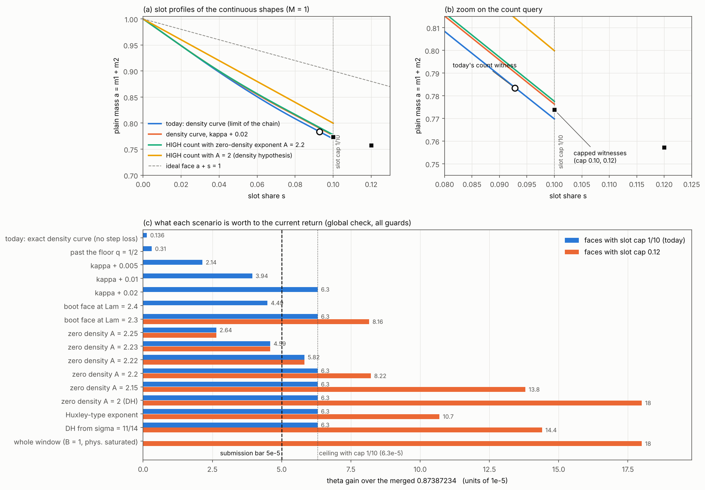

# What the return can use from a bigger energy region, and what limits ours

Date 2026-10-29. Part 2 of the shape programme: how far is today's shape from what the downstream can use, and
which new input would move it. Tags: **[Lean]** read in a built Lean file; **[derived]** our derivation;
**[numerical]** float/mpmath model of the merged return (`research/return-tuning/model.py`). Every θ below is a
**global** check: the max over the four conductor edges, δ ∈ [0, 3/4] and p ∈ [0, 1/2] of the row exponent,
with the 15 admission guards of every branch checked at each grid point (`globalcheck.py`). The faces in §2–§4
are hypothetical; nothing here is proven.

## 0. Summary

1. **The outer probe sees no wall** (`research/arvi-zone-probe/`): under GRH-type heuristics no mechanism rejects
   any point of a ∈ [0.3, 1.5], s ∈ [0, 0.3]. So "distance to the Arvi Zone" is not a useful yardstick. The
   yardstick is what the return can absorb.
2. **The return reads one point of the shape.** At the binding point (newTop edge, p = 1/2, δ ≈ 0.45), Collet's
   count needs one configuration (m, m, z) per (δ, p) [Lean, `CountAdmission.lean`, `CountCurve.lean:48`]: the
   slot share z the shape admits at plain mass 2m ≈ 0.78. The physical numerator reads the capacity at
   plain mass ≈ 0.85.
3. **The return can absorb far more than the 5e-5 bar.**
   - With faces of slot cap 1/10, every strong enough shape hits one ceiling: θ* = 0.87380931 (**−6.30e-5**).
     Then the capped witness (m, m, 1/10) with 2m = 0.7738 binds.
   - With slot cap 0.12 or more the gain reaches **−1.80e-4**. The whole window (count face B = 1, cap 0.12 or
     0.15, physical capacity saturated) is worth exactly that. It is the ceiling of the current return: past it
     the old-count region δ ≈ 0.56 binds and needs windows of its own.
4. **Today's shape gets −1.36e-6.** The continuous density curve is the limit of the density step. Two inputs
   set that limit: the HIGH payment level κ(q) and the LOW ray (floor q ≥ 1/2). Continuing past the floor
   reaches −3.1e-6 at best. Shortening the steps is worth nothing more (the curve is already the limit).
5. **The lever is the HIGH count**, i.e. how many rows of the natural dictionary carry a zero with real part
   in [3/4, 7/8].
   - Written as a zero-density exponent A (#rows ≤ H^{A(1−σ)}): the baseline's unmarked count is A ≈ 2.29–2.37,
     and PR 76's marked count matches A ≈ 2.25 in κ at the binding density.
   - The bar is crossed at a constant **A ≈ 2.226** on σ ∈ [3/4, 7/8] (A = 2.23: −4.6e-5; 2.22: −5.8e-5). From
     A = 2.21 on, the cap-1/10 ceiling (−6.3e-5) is reached.
   - A Huxley-type exponent 3/(3σ − 1) also reaches the ceiling. With cap 0.12 it gives −1.07e-4; a density
     hypothesis from σ = 11/14 gives −1.44e-4.

## 1. How the return reads a shape [Lean]

The count of bad rows at (δ, p) is the crossing of three lines. These are the inverse line I(r), the long line
L(t) and the plain line P(m) = 1 − 2δm − 2δp·z(m) (`research/return-tuning/README.md` §1.2). Collet's
`common_witness_count_bound` needs **one** admissible configuration (m, m, z(m)) at the witness m = t − r. So
the count depends on the shape only through the slot profile z at the witness.

- **Uncapped branch.** It reads a face's sloped piece z = (B − 2m)/Λ. Today the witness is (0.3917, 0.3917,
  0.0928).
- **Capped branch.** It reads z = cap. The witness at cap 1/10 is (0.3869, 0.3869, 0.1); at cap 0.12 it is
  (0.3786, 0.3786, 0.12).

A larger z at the witness lowers the count. The count face sensitivity is ∂θ/∂B ≈ −7.2e-3 at fixed Λ
(`shape/README.md` §2).

**What the global check adds.** A much stronger count face fails the guards on δ ∈ [0.33, 0.44]. There the
merged return already uses a weakened face (B − 7/4000, window `weakC7`). A bigger region still contains every
weaker face, so the check offers the merged faces and every weakening B − 0.002k of the new face. Without
this, θ* even rises (the binding jumps to the capped physical branch at δ ≈ 0.36). With it, θ* is monotone.

The **physical query** matters more than the merged-θ sensitivity suggests. At lower θ, y = h − 2ℓ shrinks
and the merged physical face loses capacity. So every scenario uses the curve's own best physical face (largest
capacity); for κ + 0.01 that face is worth −1.5e-5 by itself.

## 2. The value of a bigger shape (current return, all guards)

| count face (B, Λ, cap) | physical face | θ* | Δθ | binding |
|---|---|---|---|---|
| merged (0.96232839, 1.9265, 0.09999) | merged | 0.87387229 | grid check of 0.8738723399 | newTop δ = 0.45, C |
| B + 0.01, cap 0.11 | merged | 0.87380005 | −7.2e-5 | newTop δ = 0.45, C |
| B = 1, cap 0.12 | merged | 0.87374102 | −1.31e-4 | newTop δ = 0.56, old count |
| zone: B = 1, cap 0.12 | saturated | 0.87369209 | −1.80e-4 | newTop δ = 0.56, old count |
| zone: B = 1, cap 0.15 | saturated | 0.87369209 | −1.80e-4 | the same: the old-count region binds |

## 3. What limits today's shape [derived from the Lean gates]

The density step proves the child face from the parent face. It splits the rows by the bin b of the zero
(ν = 2b − 1) at the cut q (`sil_density_split_20261026/Density/Leaf.lean`).

- **LOW rows (ν < q).** Slots are erased and the parent is used. The cut is limited by the ray:
  q < Λ/(6B − Λ). This gives the floor q ≥ 1/2 of the marked step (`HybridGatesM.dens_mem`) and
  the native step's `overshoot` gate (q > 3/4 = 2·7/8 − 1).
- **HIGH rows (ν ∈ [q, 3/4]).** They are counted, then bounded pointwise:
  `ρ(ν)M + ν(P + s) ≤ M` (`LeafHigh.high_exponent`). So a HIGH count with exponent ρ pays exactly on
  **P + s ≤ κ_u(ν)M**, with κ_u = (1 − ρ)/ν.
  - The baseline's unmarked count ρ = 1 − 10ν/(3(5 − 2ν)) gives κ_u = 10/(15 − 6ν). It equals the return's
    count at p = 0 [numerical, exact agreement].
  - PR 76's repeated-mark gain pays on **a + κ_m s ≤ κ_m**, κ_m(ν) = 4(5 − 3ν)/(25 − 18ν) (`CONTINUUM.md`). The
    zero-density exponent cancels out of the marked gate (`base` cancels, `UNIFORM_STEP.md` §0).
- **The slope of the curve** is the crossing at which the child's new configurations become payable:
  σ = (B − κ_m)/(Λ − κ_m) for the marked count, (B − κ_u)/(Λ − 1) for a zero-density count. The binding
  density is ν = q (both κ increase in ν).
- **The slot cap 1/10.** It is c₀ = c = h₀ of the marked gain: facet (1,1) binds above it. A zero-density
  count has no facet. The scalar gates allow c < 1/6 (`ref_upper`, native `refPos`).

So the shape is pinned by κ along the path from the boot face (0.99999, 2.5715) to the floor. Its value at the
count witness is ≈ B − 0.093Λ. The curve's direction (slope σ ∈ [0.03, 0.083]) is nearly parallel to the
count's iso-θ direction (slope 0.093). That is why continuing past the floor gains almost nothing, while
raising κ lifts the whole path.

## 4. Scenarios (global θ*, curve's own count and physical faces) [numerical]

| scenario | cap 1/10 | cap 0.12 |
|---|---|---|
| today: exact density curve | −1.36e-6 | |
| past the floor (same κ(q)), best count face at Λ ≈ 1.90 | −3.1e-6 | |
| κ + 0.005 / 0.01 / 0.02 | −2.1e-5 / −3.9e-5 / −6.3e-5 | |
| boot face (0.99999, Λb), Λb = 2.5 / 2.4 / 2.3 / 2.2 | −2.0e-5 / −4.5e-5 / −6.3e-5 / −6.3e-5 | — / −4.5e-5 / −8.2e-5 / −1.32e-4 |
| zero-density exponent A = 2.25 | −2.6e-5 | −2.6e-5 |
| A = 2.23 / 2.22 / 2.21 | −4.6e-5 / −5.8e-5 / −6.3e-5 | −4.6e-5 / −5.8e-5 / −7.0e-5 |
| A = 2.2 | −6.3e-5 | −8.2e-5 |
| A = 2.15 | −6.3e-5 | −1.38e-4 |
| A = 2.1, A = 2.0 (density hypothesis) | −6.3e-5 | −1.80e-4 |
| Huxley-type, A(σ) = 3/(3σ − 1) where better | −6.3e-5 | −1.07e-4 |
| density hypothesis from σ = 11/14, Huxley below | −6.3e-5 | −1.44e-4 |

Reading: "boot at Λb" is the same as κ = 1 for q ≥ q_ray(Λb) (the HIGH rows there cost nothing). Λb = 2.4
corresponds to q = 2/3, i.e. a count with no HIGH loss for σ ≥ 5/6.

## 4b. A better plain fourth moment (face with budget 1 and slot cost c_P) [numerical, `plaincost.py`]

The face G(1, c_P) added to today's region (count and physical queries both read it; merged faces kept):

| c_P | 2.0 | 2.1 | 2.2 | 2.3 | 2.4 |
|---|---|---|---|---|---|
| Δθ | −1.80e-4 | −1.80e-4 | −1.01e-4 | −2.7e-5 | −6.5e-6 |

The bar is crossed at c_P ≈ 2.27. Today the budget-1 end of the region is the native line's end, slot cost 2.5715
(its overshoot gate, K = 3/4). Slot cost 2 is what the marked *inverse* moment already has, but its proof reflects
the Möbius-type source specifically (`original_source_energy`), so it does not transfer to plain products.

## 5. What new mathematics would pay

1. **A better HIGH count (T6).** Crossing the bar needs a zero-density exponent A ≲ 2.226 on σ ∈ [3/4, 7/8]
   for the natural dictionary (the Hecke family the density step counts). Alternatively, a repeated-mark gain
   with κ about 0.013 higher.
   - Classical comparison for full families: Ingham 3/(2 − σ) (2.4–2.67 here), Huxley 3/(3σ − 1) (2.4 → 1.85),
     density hypothesis from 11/14 (Jutila-type).
   - The family here is the sextic Hecke family. Its large sieve is full-strength up to length H, and better
     than trivial beyond (`max(1, (1+5r)/6)`, `UnmarkedDensity.unmarked_count_bound`). Whether a Huxley-type
     large-values estimate holds for it is open.
   - There is no free slack in today's unmarked count. It is the exact three-line optimum of Collet's count at
     p = 0: the return's count at p = 0 reproduces it at every δ [numerical]. The crossing t = 5/(5 − 2δ) is the
     three-line balance (`unmarkedCutoff_eq`). Improving it needs better lines, i.e. new moment or
     large-values input for the dictionary.
2. **Raise the slot cap to 0.12.** This doubles the gain of any stronger shape. It is free for a zero-density
   HIGH count (no facets). For the marked count it needs facet (1,1).
3. **Not worth it:** continuing past the floor q = 1/2, finer steps, the physical query alone.

## 6. Files

| file | content |
|---|---|
| `common.py` | θ* on one branch at the binding point, with guards (`best_theta`) |
| `globalcheck.py` | global θ*: whole grid, all guards, merged faces + weakenings available |
| `levers.py` | the curve for κ + dk / any boot face / past the floor (`curve`), binding-point pricing (`logs/levers.log`) |
| `levers_global.py` | the same, global; `logs/lg_*.log` |
| `zerodensity.py` | the curve with a zero-density HIGH count (Huxley, DH from s₀, constant A); `logs/zd_*.log` |
| `zone_value.py` | the whole window and today's exact curve; `logs/zone_value.log` |
| `pastfloor.py` | past-floor count faces; `logs/pastfloor.log` |
| `plaincost.py` | the face G(1, c_P); `logs/pc_*.log` |
| `fig_value.py` | `fig/value.png` |
